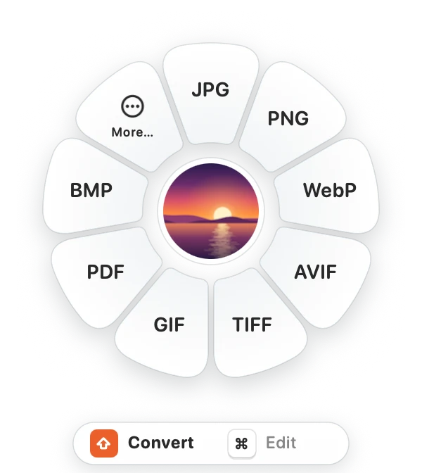
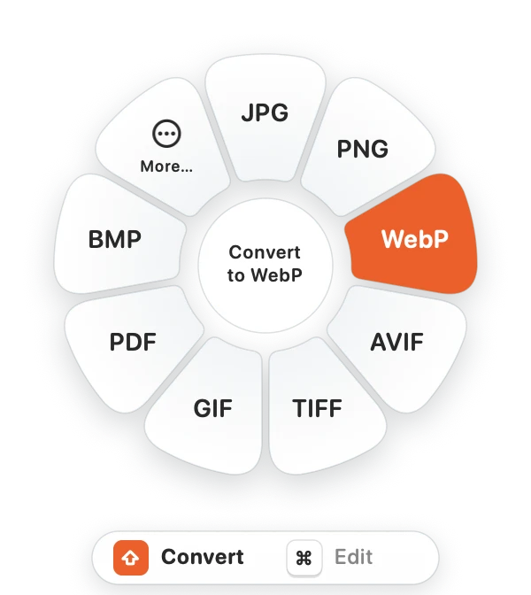
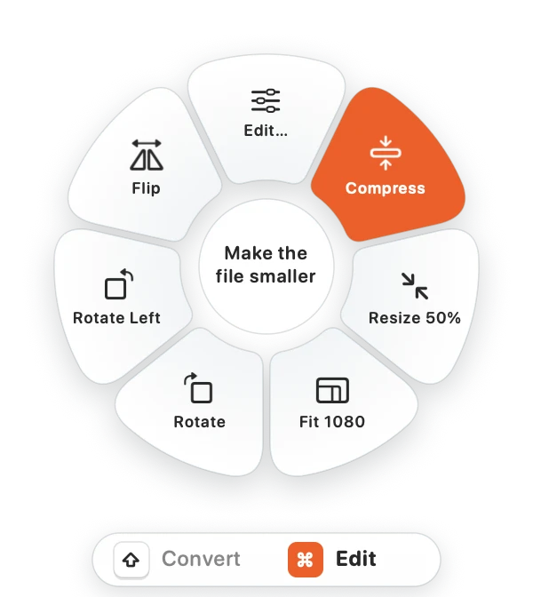
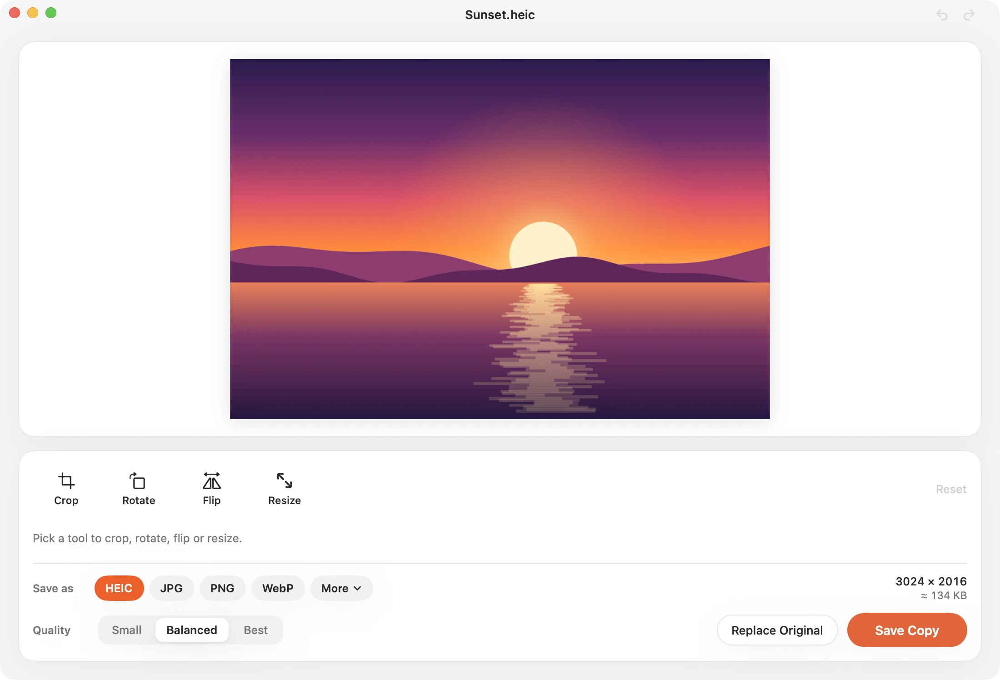
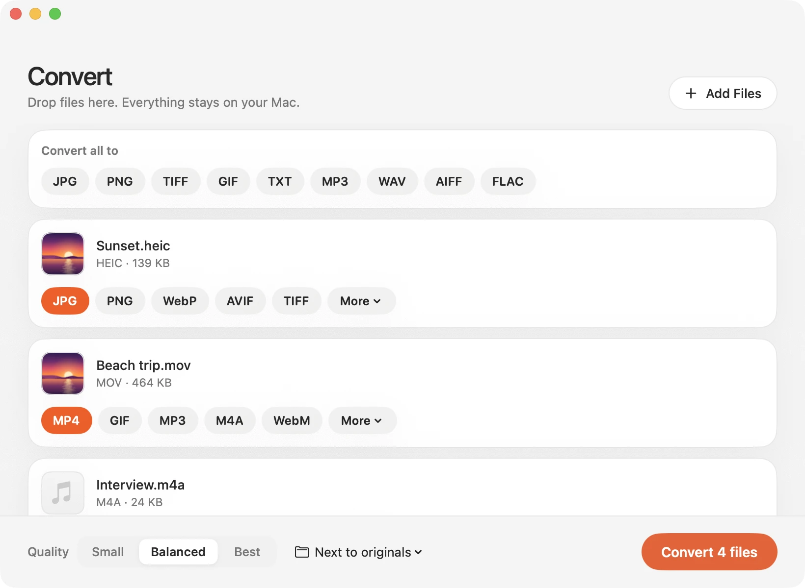

<p align="center">
  
</p>

<h1 align="center">Tangerine</h1>

<p align="center">
  <b>Convert any file in one gesture.</b><br>
  Drag a file, tap <kbd>⇧</kbd>, drop it on a format. That's it.
</p>

<p align="center">
  <a href="#install"></a>
</p>

<p align="center">
  <sub>Free · Works offline · Apple silicon · macOS 13 or later</sub>
</p>

<p align="center">
  <picture>
    <source media="(prefers-color-scheme: dark)" srcset="docs/images/wheel-dark.webp">
    
  </picture>
</p>

## How it works

1. **Drag** any file, from Finder, the desktop or a browser.
2. **Tap <kbd>⇧</kbd>** while dragging. A wheel opens with every format the file can become.
3. **Drop** it on a format. The new file appears next to the original.

<p align="center">
  
  &nbsp;&nbsp;
  
</p>

## Edit images with <kbd>⌘</kbd>

Tap <kbd>⌘</kbd> instead for one-step edits: **Compress**, **Resize**, **Rotate**, **Flip**. Choose **Edit…** for
a simple editor with crop and a live file-size estimate.

<p align="center">
  
  &nbsp;&nbsp;
  
</p>

## Convert in batches

Drop files or whole folders on the Converter. Pick a format per file or for all, choose the quality, and go.

<p align="center">
  
</p>

## What it converts

| Files | Formats |
|---|---|
| 🖼️ **Images** | JPG · PNG · HEIC · WebP · AVIF · TIFF · GIF · BMP · ICO · ICNS · PSD · SVG · RAW, and text from photos (OCR) |
| 🎬 **Video** | MP4 · MOV · MKV · WebM · AVI · WMV · GIF, including AV1, and the sound from any video |
| 🎧 **Audio** | MP3 · M4A · WAV · FLAC · AIFF · OGG · Opus · WMA · iPhone ringtones |
| 📄 **PDF&nbsp;&&nbsp;docs** | PDF to images, Word, Markdown, HTML, RTF and EPUB (scans too), and documents to PDF |

**560+ conversions**, all on your Mac: nothing is uploaded, and there's no account. Tangerine lives in the menu bar
and also works from Finder's right-click menu, with <kbd>⌃</kbd><kbd>⌥</kbd><kbd>T</kbd> on selected files, and
from the command line.

## Install

Needs a Mac with Apple silicon (M1 or later) and macOS 13 or later. **Nothing else to install**: ffmpeg and the
WebP tools are built in.

**Option 1: one command (recommended).** Open Terminal, paste this line and press Return:

```bash
curl -fsSL https://raw.githubusercontent.com/CodeLinkIO/tangerine/main/scripts/get.sh | bash
```

It downloads the app, checks it, puts it in Applications and opens it. No password, no security warning.
Run it again any time to update. ([What the script does](scripts/get.sh).)

**Option 2: the disk image.** [Download Tangerine.dmg](https://github.com/CodeLinkIO/tangerine/raw/main/Tangerine.dmg)
(6 MB), or use a copy someone sent you.

1. Open it and drag **Tangerine** onto **Applications**, then open it from Applications.
2. macOS says it can't verify the app, because it isn't notarized by Apple yet. Click **Done**.
3. Go to **System Settings → Privacy & Security**, click **Open Anyway** next to *"Tangerine" was blocked*, and
   enter your password. You only do this once.
4. If WebP, MP3 or video conversions then fail, run this once in Terminal:
   `xattr -dr com.apple.quarantine /Applications/Tangerine.app`

The warning only appears for files downloaded through a browser, AirDrop or a chat app; `curl` (Option 1)
doesn't mark files that way. Signing with a paid Apple Developer ID would remove it for the disk image too.

**First launch.** A welcome window shows a sample file to try the wheel on. *Open at login* is on by default.
The first time you use <kbd>⌃</kbd><kbd>⌥</kbd><kbd>T</kbd>, macOS asks to let Tangerine read Finder's selection.
**Uninstall:** turn off *Open at login* in Settings, quit from the menu-bar icon, and drag the app to the Trash.

---

<details>
<summary><b>All formats and options</b></summary>

| Area | Highlights |
|---|---|
| **Images** | **Inputs:** JPG, PNG, HEIC, WebP, AVIF, TIFF, BMP, GIF, SVG, ICO, ICNS, PSD, TGA, JPEG 2000, JPEG XL, EXR, camera RAW.<br>**Outputs:** JPG, PNG, HEIC, WebP, AVIF, TIFF, GIF, PDF, BMP, ICO, ICNS, JP2, TGA, plus **TXT via OCR**.<br>Animated GIF → WebP or MP4. |
| **Quick edits** (⌘ wheel) | Edit…, Compress (keeps the format: pngquant-style palette PNG, re-encoded JPG/HEIC/WebP, lossless LZW TIFF with every page, RLE TGA), Resize 50%, Fit 1080, Rotate (lossless for JPEG/HEIC/TIFF), Flip, Merge into PDF |
| **Editor window** | Kept simple: crop (Free, Original, Square, 4:3, 3:2, 16:9), rotate, flip, resize (25/50/75%, 1080/2048 px, custom), then save as JPG/PNG/HEIC/WebP… with Small/Balanced/Best quality and a live size estimate. Undo/redo |
| **Video** | MP4, MOV, M4V, 3GP natively; MKV, WebM, AVI, WMV, FLV, MPG and MTS via ffmpeg, including AV1 video. Outputs any of these plus GIF and audio extraction. Compress (HEVC), Mute. A clip without sound isn't offered audio formats or Mute; an MP4 with only sound is offered audio formats only |
| **Audio** | MP3, M4A/AAC, ALAC, WAV, AIFF, FLAC, CAF, M4R ringtone, OGG, Opus, WMA |
| **PDF** | → PNG/JPG/TIFF/HEIC (every page, 300 DPI); → TXT/MD/DOCX/RTF/HTML/EPUB with OCR for scans ("No text found" when there's nothing to read). Merge, split, compress |
| **Documents** | DOCX, DOC, RTF, RTFD, ODT, HTML, TXT, Markdown, Web Archive ↔ each other, plus → PDF and EPUB |

There are 560+ conversion options. Run `tangerine engines` to see the count on your Mac.

### Ways to convert

- **Drag wheel:** drag files anywhere, tap ⇧ (convert) or ⌘ (edit), drop on a petal. **More…** opens the Converter.
- **Converter window:** a batch queue with a target per file, options (quality, size, codec, bitrate, DPI), an output folder, and tools.
- **Menu-bar icon:** drop files on it, or use *Convert Files…* and *Edit Image…*.
- **Finder:** right-click → Services → *Convert with Tangerine* / *Edit Image with Tangerine*.
- **⌃⌥T:** opens the wheel for the current Finder selection. Pick a petal with the arrow keys and Return.
- **CLI:** `tangerine convert photo.heic --to jpg --quality 80`, `tangerine tool compress *.png`, `tangerine formats file.pdf`.
  The CLI is inside the app at `Tangerine.app/Contents/Helpers/tangerine`. It also exposes the engine tools that the
  simplified UI hides: removeBackground, autoEnhance, grayscale, stripMetadata, copyText, trimTransparent, makeSquare,
  makeIcon.

</details>

<details>
<summary><b>Build from source</b></summary>

Requirements: Xcode 15 or later, macOS 13 or later on Apple silicon, and pkg-config for building the engines.

```bash
brew install pkgconf              # once
scripts/install.sh --login        # build → /Applications/Tangerine.app, open it, turn on Open at Login
scripts/package.sh                # build → Tangerine.dmg, the download linked above
```

The first build also builds the bundled engines (about 6 minutes; see below). Later builds reuse them. It fetches
Meson and Ninja (for dav1d) into `build/engines/tools`, so they don't need installing.

| Script | Does |
|---|---|
| `scripts/build-engines.sh` | Builds the light ffmpeg, cwebp and gif2webp into `build/engines` from pinned, checksummed sources. A no-op once built; `FORCE=1` rebuilds. |
| `scripts/build-app.sh` | Release build of `build/Tangerine.app`: the app, plus the `tangerine` CLI and the engines in `Contents/Helpers`, the icon, and a signature. `ENGINES=0` leaves the engines out (Homebrew's are used if present). |
| `scripts/install.sh [--login]` | Builds, quits any running copy, replaces `/Applications/Tangerine.app` (only if it's this app), refreshes Launch Services and the Services menu, and opens it. |
| `scripts/package.sh` | Builds and wraps the app in a compressed disk image with an Applications shortcut: `build/Tangerine-<version>.dmg`, copied to `Tangerine.dmg` here. Commit that file to update the download. |
| `scripts/get.sh` | The one-line installer (see [Install](#install)): downloads the published `Tangerine.dmg` with curl, checks it and installs it. |
| `scripts/smoke-test.sh [app]` | Checks the signature and the disk image, then runs 70+ real conversions with the engine inside the app. |

**Open at login** uses `SMAppService`, so it appears in System Settings → General → Login Items.
- It can be turned on from the welcome screen (on by default), from Settings, or with `scripts/install.sh --login`.
- When the app is started from outside Applications (a disk image, Downloads), it offers to move itself there
  first, so the login item and Finder Services point at a stable copy.

**Signing.** By default the app is signed ad hoc, which is why other Macs need *Open Anyway* the first time. For a
disk image that opens anywhere without that step, sign with a Developer ID (Apple Developer Program) and
notarize. `notarytool store-credentials` is a one-time setup step.

```bash
SIGN_IDENTITY="Developer ID Application: Your Name (TEAMID)" NOTARY_PROFILE=tangerine scripts/package.sh
```

**Bundled engines.** `Contents/Helpers` holds a light ffmpeg (14 MB) and libwebp's cwebp and gif2webp, and the
app uses them before any Homebrew copy.
- ffmpeg is an **LGPL** build with only the containers, codecs and filters Tangerine uses. It encodes with Apple's
  VideoToolbox and AudioToolbox, plus LAME (MP3), Vorbis, Opus and VP9, and decodes AV1 with dav1d. It has no network code, and leaves out
  playlist formats that can pull in other files.
- Everything is static and arm64 for macOS 13 or later; only macOS's own libraries are linked.
- The lists live in `scripts/build-engines.sh`. When adding a format to `MediaFormats`, add its demuxer, decoder,
  encoder or muxer there.
- AV1 video is read with dav1d, so it works on Macs without an AV1 hardware decoder (before M3).
- Licenses and the exact source URLs are in `Tangerine.app/Contents/Resources/Licenses`.

</details>

<details>
<summary><b>Testing</b></summary>

```bash
swift test                               # 299 unit tests (~2 min), edge cases and security regressions included
swift test --filter TangerineImageTests  # one suite
scripts/package.sh && scripts/smoke-test.sh   # the built app and Tangerine.dmg, end to end (~15 s)

# Every conversion through the bundled light ffmpeg; Homebrew's full ffmpeg only makes the test files.
TANGERINE_FFMPEG=$PWD/build/engines/bin/ffmpeg TANGERINE_FIXTURE_FFMPEG=/opt/homebrew/bin/ffmpeg swift test
```

- **Unit tests** cover the image, media and document engines, routing and batches, the CLI, and the editor and
  Converter logic. Tests that need ffmpeg or libwebp skip themselves when those aren't installed.
- **The smoke test** makes its fixtures on the fly (a PNG, a Markdown note, a spoken AIFF, a clip made from them),
  prints ✓/✗ per check, and exits non-zero on a failure. It checks that the bundled engines are the ones used, link
  only macOS libraries and are LGPL, runs 70+ conversions, and reports Gatekeeper and Open at Login status.
- **By hand**, since automated runs can't send drag events: drag a file and tap ⇧, then ⌘; drop on a petal;
  try the Converter window, the editor, ⌃⌥T, Finder Services, dark mode, and log out and in to check Open at
  Login. For a first-run experience, run `defaults delete dev.tangerine.converter` before opening the app.

Debug builds open any screen directly, without input events, for screenshots:

```bash
swift build
TANGERINE_DEMO=wheel TANGERINE_DEMO_FILE=~/Pictures/photo.jpg .build/debug/TangerineApp
# TANGERINE_DEMO = wheel | tools | converter | settings | welcome | editor | hud
# TANGERINE_DEMO_DARK=1 for dark mode, TANGERINE_DEMO_PETAL=2 to highlight a petal (the README images)
```

</details>

<details>
<summary><b>Architecture</b></summary>

```
TangerineCore       formats, options, backend protocols, output naming, Shell, FFmpeg, OCR
TangerineImage      ImageIO/Core Image engine, quick edits, EditRecipe pipeline, PNG quantizer, WebP
TangerineMedia      AVFoundation + afconvert + ffmpeg engines (video/audio), compress/mute
TangerineDocuments  PDFKit rasterizing/extraction, Markdown, AppKit text formats, EPUB, PDF tools, HTML sanitizer
TangerineKit        Engine: routes (from → to) and tools to backends, batches, folders, progress, reports
TangerineApp        menu-bar app: Theme (design system), drag monitor, wheel, HUD, converter, editor, settings, onboarding
TangerineCLI        `tangerine` command-line tool
```

The UI follows the tangerineformac.com look: an off-white page with white rounded cards, orange format chips,
pill segmented controls and keycap legends, in light and dark mode. Every screen uses the components in
`Sources/TangerineApp/Theme.swift`.

The wheel detects drags without Accessibility permission. A mouse-down starts a short timer that watches the
system drag pasteboard and the global modifier state; the wheel itself is a non-activating panel that accepts
the drop.

</details>

<details>
<summary><b>Before shipping</b></summary>

- **Rename and rebrand.** "Tangerine" is another company's product name.
- **Keep the engine licenses.** The LGPL asks that ffmpeg's and LAME's source be available to anyone who gets the app.
  `Contents/Resources/Licenses/README.txt` lists the exact upstream tarballs; for a commercial release, also keep
  copies of them.
- **Sign and notarize** with a Developer ID. For the Mac App Store you'd also need sandboxing work: security-scoped
  output folders, and helper tools signed inside the bundle.
- **Not built yet:** region redact, annotate, watermark, batch edit recipes, full-resolution zoom in the editor, and
  data (CSV/XLSX/JSON), subtitle (SRT/VTT) and archive (ZIP/TAR) conversions.

</details>

<p align="center"><sub>Inspired by <a href="https://tangerineformac.com/">Tangerine for Mac</a>.</sub></p>
